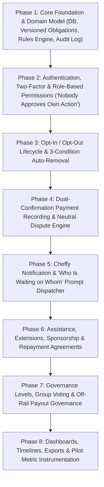

# ThePotLite V1 Pilot — Complete Implementation Plan

**Spec Version**: V1 Pilot Spec (October 16, 2026)  
**Governing Principle**: *"No money handled. No disputes adjudicated. No obligations silently changed."*  
**Core Vertical**: Youth Sports (Directors, Coaches, Treasurers, Parents)  

---

## 1. Executive Summary & Architectural Shift

ThePotLite V1 represents a deliberate, disciplined architectural pivot from a custodial, payment-rail-handling model (Stripe / Moov / Unit / wallets) to a **non-custodial governance, tracking, and consent-gated accountability engine**.

```
+---------------------------------------------------------------------------------------------------------+
|                                    ARCHITECTURAL COMPARISON                                             |
+------------------------------------+-----------------------------------+--------------------------------+
| FEATURE / DOMAIN                   | LEGACY CODEBASE                   | THEPOTLITE V1 PILOT            |
+------------------------------------+-----------------------------------+--------------------------------+
| Financial Rail                     | Stripe / Moov ACH / Card holds    | ZERO money handled; off-rail   |
| Primary Domain Object              | Pot                               | Per-Member Obligation          |
| Obligation Mutability              | Admin edits balance / goal        | Versioned, consent-gated state |
| Approvals                          | Self-approval possible            | Strict "Nobody approves self"  |
| Disputes                           | System adjudicates / chargebacks  | Dual statement logged; neutral |
| Notifications / Reminders          | Generic blast messages            | Cheffy "Who is waiting on whom"|
| Assistance & Hardship              | Public dropouts / manual handling | Private Yellow path / sponsor  |
| Minor (Children) Privacy           | Unrestricted                      | COPPA: First name + Last initial|
| Audit Trail                        | Ephemeral / mutable rows          | Append-only event ledger       |
+------------------------------------+-----------------------------------+--------------------------------+
```

---

## 2. Phased Implementation Roadmap



---

### Phase 1: Core Foundation, Domain Model & Append-Only Audit Log
* **Objective**: Build the foundational data structures and state machines adhering to the spec.
* **Key Deliverables**:
  1. **Organizations & Teams**:
     - `organizations`: Holds org profile, payout policy, active rule version.
     - `teams`: Belongs to an org, connects families and coach.
     - `players`: Child representation under parent user (First name + Last initial only, strictly COPPA compliant).
  2. **Pots**:
     - Pot types: `season fee`, `tournament`, `uniforms and gear`, `travel`, `fundraiser`, `other`.
     - Attached to organization, team, and snapshot of org rule version.
     - Auto-completes when all obligations reach `Confirmed`.
  3. **Versioned Consent-Gated Obligations State Machine**:
     - The per-member obligation is the primary object.
     - States: `Invited` -> `Accepted` -> `Partially paid` -> `Paid (pending confirmation)` -> `Confirmed`.
     - Side states: `Overdue`, `Assistance pending`, `Change pending`, `Disputed`, `Withdrawn`, `Removed`.
     - `obligation_versions`: Any change to amount or schedule creates a new pending version. The prior version stays legally and structurally in force until the member explicitly accepts the new one.
     - `installments`: Dated parts (e.g., $300 split into 3 x $100).
  4. **Human Rules Engine Configuration**:
     - Versioned condition -> action table (`if state = X and time since Y > N then do Z`).
     - 11 V1 defaults: reminder schedule, grace period, confirmation window, final notice, invite expiry, auto-removal, assistance visibility, vote thresholds, minor-change limit, payout approval, quiet hours.
  5. **Append-Only Audit Event Ledger**:
     - Immutable event log capturing `actor`, `role`, `action`, `object`, `before_state`, `after_state`, `terms_version`, `timestamp`. Never edited or deleted.

---

### Phase 2: Authentication, Two-Factor & Role-Based Permissions
* **Objective**: Establish server-enforced security and the governing principle: *"Nobody approves their own action."*
* **Key Deliverables**:
  1. **Two Core Roles**:
     - **Organizer**: Directors, coaches, treasurers, team parents.
     - **Member**: Paying adults, sponsors (grandparents/boosters).
  2. **Security & Anti-Self-Approval Enforcement**:
     - A payout requested by Organizer A cannot be approved by Organizer A.
     - Payment confirmation requires Organizer + Member handshake.
     - 2-factor login (TOTP/SMS) for Organizers.
     - No player/minor accounts.
  3. **Sponsor Privacy Scope**:
     - Sponsors see only the specific coverage they agreed to; zero access to extraneous family or financial data.

---

### Phase 3: Opt-In, Opt-Out & Auto-Removal Engine
* **Objective**: Implement frictionless tokenized onboarding, consent capture, and safe exit handling.
* **Key Deliverables**:
  1. **Opt-In Flow**:
     - Tokenized invite link via SMS/Email (no mobile app download required).
     - Pre-acceptance disclosure: displays Pot purpose, exact amount/schedule, deadline, org rules.
     - Acceptance stamp: records `member_id`, `terms_version`, `timestamp`.
     - 72h default invite expiration with pre-expiry Cheffy nudge.
  2. **Opt-Out (Withdrawal) Flow**:
     - Member can withdraw at any time; optional feedback collected.
     - If no confirmed payment -> obligation closes as `Withdrawn`.
     - If after confirmed payment -> payment remains recorded; refund agreement recorded as a separate record-only agreement.
     - Pot goal & remaining shares flagged `Change pending`.
  3. **Strict 3-Condition Auto-Removal**:
     - System auto-removes *only* when:
       1. No response within org response window (12 hours after final notice).
       2. No confirmed payment exists.
       3. No active assistance arrangement exists.
     - In all other cases: escalates to organizers; never drops silently.

---

### Phase 4: Dual-Confirmation Payment Recording & Neutral Disputes
* **Objective**: Track off-platform payment methods with mutual verification and neutral dispute logging.
* **Key Deliverables**:
  1. **Payment Initiation & Methods**:
     - Supported offline methods: `cash`, `Cash App`, `Zelle`, `Venmo`, `check`, `other app`, `other`.
     - Initiated by either side: Member ("I sent $X") or Organizer ("Received $X").
     - Records amount, method, date sent, reference note, optional receipt upload, installment target.
  2. **Handshake Confirmation**:
     - Applies to obligation balance only when both parties confirm.
     - Partial payment allocation to specific installments.
  3. **Dispute Handling**:
     - Amount mismatch or denial ("not received") shifts record to `Disputed`.
     - Both statements logged side-by-side.
     - Cheffy notifies both parties and organizers.
     - System strictly adheres to: *"ThePotLite never decides who is right."*
  4. **Progress Visualizer**:
     - Confirmed totals only count toward the primary goal bar.
     - Pending amounts rendered in a distinct, separate status band.

---

### Phase 5: Cheffy Notification & "Who is Waiting on Whom" Dispatcher
* **Objective**: Deliver contextual, targeted reminders based on individual bottleneck states.
* **Key Deliverables**:
  1. **Targeted State Machine Dispatch**:
     - Cheffy never blasts all members. Prompts go strictly to the individual blocking progress.
     - Prompt triggers:
       - `Member to accept`: In or out?
       - `Member to pay (upcoming)`: Green (on track), Yellow (need time/help), Red (want to leave).
       - `Member to pay (past due)`: Date proposal / need help / leave.
       - `Organizer to confirm`: Verification of member-reported payment.
       - `Member to confirm`: Verification of organizer-reported receipt.
       - `Member to accept change`: Post-vote terms acceptance.
       - `Approver to approve`: Payout sign-off.
  2. **Cadence & Quiet Hours**:
     - Cadence: 7, 3, 1 days before due; day after; every 2 days x3; then escalate to organizer.
     - Strict quiet hours: No SMS between 9:00 PM and 8:00 AM local time.
     - Tone: Neutral, factual, direct. No shaming, no public delinquency badges.
     - AI boundary: May draft language and suggest proposals; cannot change money, dates, or approvals.

---

### Phase 6: Assistance, Extensions, Sponsorship & Repayments
* **Objective**: Eliminate financial dropout stigma through dignified, consent-controlled workflows.
* **Key Deliverables**:
  1. **The Yellow Path**:
     - Member chooses need: **More Time** or **Financial Help**.
     - Privacy boundary: Member selects visibility (Organizers Only [default] vs. Organizers + Group).
  2. **More Time (Extensions)**:
     - Member proposes new date. Organizer accepts, counters, or declines.
     - Both must accept for the new obligation version to activate.
  3. **Financial Help & Sponsorship**:
     - Organizer options: personal coverage, scholarship fund, group ask (if permitted), or decline.
     - Sponsorship record: separate tracking of sponsor, member, installment, and amount.
     - Repayment terms: separate bilateral record between sponsor and member. Marked as Gift if no repayment expected.
     - Does not alter Pot goal or inflate ledger.

---

### Phase 7: Multi-Level Governance & Off-Rail Payout Governance
* **Objective**: Provide structured, democratic decision-making and transparent vendor payout auditing.
* **Key Deliverables**:
  1. **4 Governance Levels**:
     - *Level 1 (Org rules)*: Reminders, windows, thresholds (Organizer sets).
     - *Level 2 (Pot terms)*: Minor non-financial changes (Organizer applies, members notified).
     - *Level 3 (Group vote)*: Changes affecting multiple members' dues (Member vote).
     - *Level 4 (Individual acceptance)*: Individual's own amount/dates (Affected member must accept).
  2. **Group Voting Engine**:
     - Eligible: Active members with Accepted or later obligations.
     - Rules: Simple majority, 50% quorum, 48h deadline. Ties fail.
     - Dissent transparency: 'No' votes require a written reason, routed to organizers only.
     - Post-pass rule: Each affected member still must accept their updated terms version!
  3. **Payout Governance (Off-Rail Spend)**:
     - Spend request: Payee, amount, purpose, date needed, source Pot.
     - Threshold routing:
       - Under $250: Standard dual-organizer sign-off.
       - Over $250: Minimum 2 approvers.
       - Over $1,000: Mandatory group vote.
     - Disbursed recording: Method, date, invoice/receipt attachment.
     - Cap: Disbursed spend can never exceed the Pot's confirmed balance.
     - Full visibility to member families.

---

### Phase 8: Dashboards, Timelines, Exports & Pilot Instrumentation
* **Objective**: Deliver operational clarity for organizers and frictionless visibility for parents.
* **Key Deliverables**:
  1. **Organizer Dashboard**:
     - Unified "Needs You" action queue (confirmations, disputes, assistance, payouts).
     - Per-pot summary (confirmed vs goal, paid/pending/overdue).
     - Per-family seasonal ledger.
  2. **Parent Dashboard**:
     - Mobile-friendly single view of active Pots.
     - Glowing indicators for pending Cheffy actions.
     - One-tap responses.
  3. **Audit Timeline & Exports**:
     - Plain-language event stream per Pot and member.
     - PDF and CSV generation for org records.
  4. **Pilot Telemetry & Instrumentation**:
     - Tracking core metrics: Pot completion rate, Days to fully paid, On-time rate, Cheffy response time, Dispute frequency, Assistance outcomes, Change acceptance rate, and Organizer time saved.

---

## 3. Immediate Focus: Phase 1 Implementation Plan

We begin immediately with **Phase 1: Core Foundation & Domain Model**:
1. **Schema Definition (`shared/thepotlite-schema.ts`)**:
   - `organizations` & `org_rules` (versioned condition -> action table with 11 pilot defaults)
   - `teams` & `players` (COPPA compliant child profiles)
   - `pots` (youth sports collection categories, rules snapshot, completion check)
   - `obligations` (per-member core object, states, version pointer)
   - `obligation_versions` (immutable snapshots of amount and schedule, consent tracking)
   - `installments` (sub-obligation payment milestones)
   - `audit_events` (append-only ledger of state transitions)
   - `payments_recorded` (dual confirmation offline transactions)
   - `payout_records` & `payout_approvals` (spend governance)
   - `assistance_requests` & `sponsorship_records` (hardship handling)
   - `governance_proposals` & `governance_votes` (voting engine)
   - `cheffy_prompts` (targeted prompt dispatch queue)
2. **Core Storage & Service Layer (`server/thepotlite-core.ts`)**:
   - Organization & default rules initialization
   - Team & COPPA player registration
   - Pot initialization with rule version snapshot
   - Versioned obligation creation with installment generation
   - Consent-gated version transition engine (previous version stays active until accepted)
   - Append-only audit logger
3. **Type Safety & Integration Validation**:
   - Full TypeScript compile verification (`npx tsc --noEmit`).

