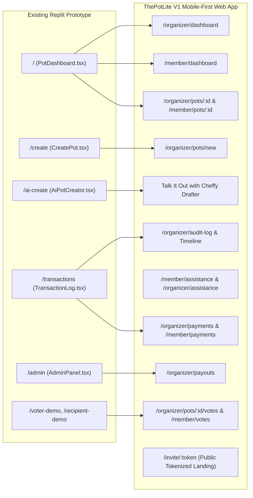

# ThePotLite V1 — Replit Codebase Audit & Migration Map

**Document Version:** 1.0  
**Source of Truth:** *ThePotLite V1 Pilot Spec* (October 16, 2026) & *Upgraded Product Architecture & Frontend Implementation Plan*  
**Audience:** Product Engineering, Frontend, Backend, QA, Deployment  
**Governing Principle:** *"No money handled. No disputes adjudicated. No obligations silently changed."*  

---

## 1. Executive Summary & Audit Overview

This audit evaluates the existing prototype repository (`TP-_Stripe_repo`) against the non-negotiable architectural boundaries of **ThePotLite V1 Pilot**. 

The existing codebase was originally built as a single-browser sandbox/demo prototype with client-side `localStorage` state management, and later partially retrofitted with prototype integrations for **Stripe**, **Moov**, and **Unit** fintech rails. 

### Critical Non-Negotiable Boundary
ThePotLite V1 is **not** a payment processing platform:
* It **never** moves, holds, or processes money.
* It does not use Stripe, Moov, Unit, Plaid, bank accounts, card processing, or digital wallets.
* Payments occur **off-platform** (cash, Cash App, Zelle, Venmo, check, or other app).
* The core domain object is the **per-member Obligation**, not the Pot balance.
* All changes to obligations are **versioned and consent-gated** (previous version remains in force until explicitly accepted).
* **"Nobody approves their own action"**: strict separation of duties for payments and payouts.

```
+------------------------------------------------------------------------------------------------------------------------+
|                                              REPLIT PROTOTYPE VS V1 TARGET                                             |
+------------------------------------+-------------------------------------------+---------------------------------------+
| DOMAIN / COMPONENT                 | CURRENT REPLIT PROTOTYPE                  | TARGET THEPOTLITE V1 PILOT            |
+------------------------------------+-------------------------------------------+---------------------------------------+
| Money Movement                     | Simulated Wallets, Stripe & Moov ACH      | ZERO money moved (off-rail tracking)  |
| Primary Domain Entity              | `pots` (aggregate balance)                | `obligations` (per-member milestones) |
| State Management                   | Browser `localStorage` & React Context    | Server PostgreSQL + React Query       |
| User Identity & Auth               | `DummyUserContext` ("Current User")       | Adult Auth, RBAC (Organizer / Member) |
| Minor (Children) Data              | Unrestricted / mock strings               | COPPA-safe (First name + Last initial)|
| Payment Confirmation               | Simulated 1-click debit / checkout modal  | Two-party mutual verification         |
| Disputes                           | None / simulated API errors               | Neutral dual-statement logging        |
| Reminders & Cheffy                 | Generic toast / static checklist          | Targeted "Who is waiting on whom"     |
| Hardship & Assistance              | None (unpaid dropouts)                    | Private Yellow path & Sponsorship     |
| Governance & Voting                | Client-side percentage toggle             | 4 Levels, Quorum, Individual consent  |
| Payouts                            | Automated transfer to connected account   | Recorded off-rail spend + 2 approvers |
| Audit Trail                        | Ephemeral transaction log table           | Append-only immutable event ledger    |
+------------------------------------+-------------------------------------------+---------------------------------------+
```

---

## 2. Inventory & Audit of Existing Codebase

### 2.1. Frontend Routes Inventory (`client/src/App.tsx`)

| Existing Route | Component | Current Implementation Analysis | V1 Decision |
|---|---|---|---|
| `/` | `PotDashboard.tsx` | Monolithic (89KB) sandbox view. Relies on `PotContext` & `localStorage`. Displays fake personal wallet balance, deposit simulators, Stripe modals, and Moov funding modals. | **REPLACE** with dedicated Organizer and Member Dashboards |
| `/onboarding` | `Onboarding.tsx` | Simple welcome splash redirecting to pot creation. | **UPGRADE** to mobile-first adult onboarding & invite acceptance |
| `/create` | `CreatePot.tsx` | Large form (56KB) with wizard tabs, payout structures (`one-to-many`, `many-to-one`), and withdrawal methods (`democratic`, `admin`, `timed`, `auto-withdraw`). | **ADAPT & REFACTOR** for youth sports V1 Pot types and rules |
| `/ai-create` | `AiPotCreator.tsx` | Prompt input calling `/api/pots/ai-draft` (N8N webhook stub). | **ADAPT** as "Talk It Out with Cheffy" organizer drafting assistant |
| `/ai-invite-members`| `AiPotInviteMembers.tsx`| Textarea parsing member emails/names. | **ADAPT** to tokenized SMS/Email invitation link generator |
| `/transactions` | `TransactionLog.tsx` | Flat list of mock deposits, transfers, and payouts. | **REPLACE** with Append-Only Audit Log and Payment History |
| `/feedback` | `FeedbackForm.tsx` | Rating and comments form writing to `/api/feedback`. | **KEEP & ADAPT** for pilot feedback collection |
| `/admin` | `AdminPanel.tsx` | Demo reconciliation controls, Moov/Unit webhook simulation triggers. | **DEPRECATE** (Prototype fintech admin; replace with Org Rules & Audit) |
| `/voter-demo` | `VoterDemo.tsx` | Hardcoded mock voting toggle for demoing user roles. | **DEPRECATE** (Replace with genuine Level 3 governance voting) |
| `/recipient-demo`| `RecipientDemo.tsx` | Hardcoded payout demo view. | **DEPRECATE** (Replace with transparent Payout Governance page) |

---

### 2.2. Frontend Components Inventory (`client/src/components/`)

| Existing Component | Current Role & Gaps | V1 Migration Action |
|---|---|---|
| `PaymentFundingModal.tsx` | Handles Moov ACH bank accounts and micro-deposits. | **DEPRECATE & REMOVE** (No bank accounts or ACH in V1) |
| `StripePaymentModal.tsx` | Stripe Elements card input and payment intent. | **DEPRECATE & REMOVE** (No card processing in V1) |
| `DepositSim.tsx` | Sandbox slider adding money to fake local balance. | **DEPRECATE & REMOVE** (Replaced by off-rail Payment Submission) |
| `PayoutDistributionModal.tsx`| Executes automated bank payouts to users. | **REPLACE** with Recorded Disbursement Modal (checks/receipts) |
| `TimedRelease.tsx` | Client-side timer unlocking funds at date. | **REPLACE** with Installment Schedule milestone viewer |
| `ChangeRequestVoting.tsx` | Simple client-side change request voting widget. | **ADAPT** into Governance Proposal Card & Voting UI |
| `VotingUI.tsx` | Basic thumbs up/down vote component. | **ADAPT** into Level 3 voting component (requires 'No' reason) |
| `PotInviteSystem.tsx` | Shareable link copy + email simulation. | **UPGRADE** to tokenized, mobile-friendly invitation flow |
| `MilestoneCelebration.tsx` | Confetti canvas on reaching goal amount. | **KEEP** for automatic Pot completion celebration |
| `FeatureChecklist.tsx` | Prototype feature checklist widget. | **DEPRECATE** (Testing artifact; remove from production shell) |
| `FeedbackModal.tsx` | Triggered modal for feedback submission. | **KEEP** for pilot user feedback |
| `Navbar.tsx` | Top bar with role dropdown (`admin`, `voter`, `recipient`). | **REPLACE** with role-aware AppShell (Organizer vs Member) |
| `Footer.tsx` | Static prototype footer. | **KEEP & ADAPT** with V1 legal terms and privacy notices |
| `SplashGate.tsx` / `SplashScreen.tsx` | Initial splash screen. | **KEEP & POLISH** for mobile-first brand loading |
| `ui/*` (49 Radix/Shadcn primitives) | Buttons, Dialogs, Tooltips, Toasts, Cards, Inputs. | **PRESERVE 100%** as the shared UI component library |

---

### 2.3. Client Contexts & State Management (`client/src/context/`)

1. **`DummyUserContext.tsx`**:
   * *Current State*: Stores `"Current User"` and allows switching roles (`admin`, `voter`, `recipient`) via client state.
   * *Problem*: No real multi-user security, passwords, or persistent identity.
   * *V1 Target*: Implement real JWT/Session-based `AuthContext` with two roles: **Organizer** and **Member**, plus COPPA-compliant player dependents.
2. **`PotContext.tsx`**:
   * *Current State*: Stores pots in `localStorage` (`thePot_pots`), provides `depositFromPersonalToPot()`, `personalPot.balance`.
   * *Problem*: Client-authoritative, mutations do not persist to a multi-device server, contradicts the non-custodial obligation state model.
   * *V1 Target*: Replace with **TanStack React Query** communicating with the backend REST API (`/api/v1/...`).

---

### 2.4. Backend API Routes Inventory (`server/routes.ts`)

| Existing Endpoint | Type / Focus | V1 Pilot Disposition |
|---|---|---|
| `GET /api/pots` | Core Pot CRUD | **UPGRADE** to filter by organization & role |
| `GET /api/pots/:id` | Core Pot CRUD | **UPGRADE** to include obligations & rule snapshot |
| `POST /api/pots` | Core Pot CRUD | **UPGRADE** to validate V1 pot types & snapshot rule v1 |
| `PATCH /api/pots/:id` | Core Pot CRUD | **RESTRICT** (Changes must go through Governance Levels) |
| `DELETE /api/pots/:id` | Core Pot CRUD | **REPLACE** with soft-state transition / withdrawal |
| `POST /api/pots/:potId/members` | Pot Membership | **REPLACE** with tokenized invitation & acceptance |
| `GET /api/pots/:potId/transactions` | Prototype Ledger | **REPLACE** with Append-Only Audit Trail (`/api/v1/audit-events`) |
| `POST /api/feedback`, `GET /api/feedback` | Feedback | **KEEP** |
| `POST /api/promo-code/*` (4 endpoints) | Promo Engine | **DEPRECATE** (Out of scope for V1 pilot) |
| `POST /api/pots/ai-draft` | AI Assistant | **UPGRADE** to "Talk It Out with Cheffy" proposal drafter |
| `POST /api/webhooks/moov` | Moov Webhook | **DEPRECATE & REMOVE** (No Moov in V1) |
| `GET /api/moov/config` | Moov Config | **DEPRECATE & REMOVE** (No Moov in V1) |
| `POST /api/webhooks/unit` | Unit Webhook | **DEPRECATE & REMOVE** (No Unit in V1) |
| `POST /api/payments/funding` | ACH Funding | **DEPRECATE & REMOVE** (No ACH in V1) |
| `POST /api/payments/withdrawals` | Bank Transfer | **DEPRECATE & REMOVE** (No in-app transfers in V1) |
| `POST /api/payments/transfers` | Wallet Transfer | **DEPRECATE & REMOVE** (No wallet transfers in V1) |
| `GET /api/banking/accounts` | Plaid/Banking | **DEPRECATE & REMOVE** (No bank linking in V1) |
| `GET /api/payments/fees` | Fintech Fees | **DEPRECATE & REMOVE** (No platform fees on pilot) |
| `GET /api/admin/reconciliation` | Bank Reconcile | **DEPRECATE & REMOVE** (No bank accounts to reconcile) |
| `POST /api/admin/unit/simulate` | Sandbox Test | **DEPRECATE & REMOVE** |
| `POST /api/admin/moov/simulate` | Sandbox Test | **DEPRECATE & REMOVE** |
| `GET /api/stripe/config` | Stripe Config | **DEPRECATE & REMOVE** (No Stripe in V1) |
| `POST /api/webhooks/stripe` | Stripe Webhook | **DEPRECATE & REMOVE** (No Stripe in V1) |
| `POST /api/payments/create-intent` | Stripe Intent | **DEPRECATE & REMOVE** (No Stripe in V1) |
| `POST /api/payments/checkout-session`| Stripe Checkout | **DEPRECATE & REMOVE** (No Stripe in V1) |
| `POST /api/payments/:id/refund` | Stripe Refund | **DEPRECATE & REMOVE** (Replaced by record-only refund agreement) |
| `POST /api/pots/:id/payout` | Auto Payout | **REPLACE** with Recorded Spend + 2 Approvers Workflow |

---

## 3. Classification Taxonomy

### Group 1: What to KEEP & REUSE
* **UI Component Primitives**: All 49 Radix UI / Shadcn components in `client/src/components/ui/` (buttons, dialogs, dropdowns, inputs, tabs, toasts, popovers, badges).
* **Styling & Theme**: Tailwind configuration, responsive grid, primary brand colors (purple `#7C3AED`, gold accents, dark mode palette).
* **Base Form UX**: The form layout patterns in `CreatePot.tsx` (wizard steps, tooltips, validation styling).
* **Feedback System**: `FeedbackForm.tsx` and `FeedbackModal.tsx` for capturing organizer and parent user experience.
* **Celebration Effects**: `MilestoneCelebration.tsx` for visual feedback upon 100% confirmed Pot completion.

### Group 2: What to DEPRECATE & PURGE from V1
* **Stripe Integration**: `server/stripe/*`, Stripe webhook handlers, checkout sessions, payment intents, `StripePaymentModal.tsx`.
* **Moov & Unit Integrations**: `server/modules/payments/*`, bank connection endpoints, micro-deposits, funding flows, fee engines, reconciliation tables.
* **Virtual Personal Wallets**: `personalPot.balance`, simulated deposits/withdrawals, `DepositSim.tsx`.
* **Sandbox Roles Dropdown**: Hardcoded `admin`/`voter`/`recipient` role switcher in `DummyUserContext.tsx`.
* **In-Memory LocalStorage Sync**: `thePot_pots`, `thePot_transactions` browser storage persistence.

### Group 3: What to BUILD NEW for V1
* **Per-Member Versioned Obligations**: State machine, installment scheduling, consent-gated version updates.
* **Two-Party Offline Payment Handshake**: Recording cash, Cash App, Zelle, Venmo, check; dual sign-off; neutral dispute logging.
* **COPPA Minor Model**: Child representation attached to parent membership (`firstName` + `lastInitial` only).
* **Human Rules Engine (V1 Defaults)**: Versioned condition -> action table (72h expiry, 48h confirmation, 12h final notice, $250/$1,000 payout thresholds, quiet hours).
* **Cheffy "Waiting on Whom" Dispatcher**: State-driven prompt delivery targeting only the bottleneck party.
* **Assistance & Sponsorship (Yellow Path)**: Confidential hardship requests, date extension negotiation, sponsor coverage records, repayment agreements.
* **4-Level Governance & Group Voting**: Thresholds, quorum, dissent reasons, and post-vote individual acceptance.
* **Off-Rail Payout Governance**: Multi-approver routing, spend ledger, receipt/invoice attachment, confirmed balance cap.
* **Append-Only Audit Ledger & CSV/PDF Exports**: Immutable event logging with human-readable timeline generation.
* **Dual Role Dashboards**: Organizer "Needs You" triage queue and Parent mobile-first glowing status dashboard.

---

## 4. Route-to-Route & Component Migration Matrix



### Detailed Route Migration Specifications

| Legacy Screen | Upgraded V1 Route | Component / Module | Target API Dependencies | Migration Requirements & Acceptance Criteria |
|---|---|---|---|---|
| **Root Dashboard** (`/`) | `/organizer/dashboard` | `features/dashboard/OrganizerDashboard.tsx` | `GET /api/v1/organizer/dashboard-summary`<br>`GET /api/v1/organizer/needs-you-queue` | **Organizer View**: Single-screen "Needs You" queue (pending confirmations, disputes, assistance, exits, payouts). Per-Pot status cards with confirmed totals only. |
| **Root Dashboard** (`/`) | `/member/dashboard` | `features/dashboard/MemberDashboard.tsx` | `GET /api/v1/member/dashboard-summary`<br>`GET /api/v1/cheffy/active-prompts` | **Parent View**: Mobile-first single view. Glowing card for pots requiring action. One-tap Cheffy responses. Payout transparency cards. |
| **Pot Detail Modal** | `/organizer/pots/:id`<br>`/member/pots/:id` | `features/pots/PotDetailView.tsx` | `GET /api/v1/pots/:id`<br>`GET /api/v1/pots/:id/obligations` | Displays goal progress using **confirmed totals only**. Shows member obligation breakdown, installment schedule, and plain-language activity timeline. |
| **Create Pot** (`/create`) | `/organizer/pots/new` | `features/pots/CreatePotWizard.tsx` | `POST /api/v1/pots` | Select V1 Pot Type (`season fee`, `tournament`, `uniforms and gear`, `travel`, `fundraiser`, `other`). Sets deadline and allocation. Snapshots active `rule_version_id`. |
| **AI Pot Creator** (`/ai-create`) | Embedded Drawer | `features/cheffy/TalkItOutCheffy.tsx` | `POST /api/v1/cheffy/draft-proposal` | Renamed "Talk It Out with Cheffy". Helps organizers draft budgets and proposals based on active rules. Cannot directly activate or mutate state. |
| **Member Invites** (`/ai-invite-members`) | `/invite/:token` | `features/invitations/PublicInviteLanding.tsx` | `GET /api/v1/invitations/:token`<br>`POST /api/v1/invitations/:token/accept` | Public, mobile-friendly landing page (no app download required). Displays full terms, schedule, rules. Records explicit acceptance with timestamp and version. |
| **Deposit Modal** (`DepositSim` / `StripeModal`) | `/member/payments/new`<br>`/member/payments/:id` | `features/payments/PaymentRecordModal.tsx` | `POST /api/v1/obligations/:id/payments`<br>`POST /api/v1/payments/:id/confirm` | Payer marks "I sent $X" with method (`cash`, `Zelle`, `Venmo`, `Cash App`, `check`, `other`). Organizer confirms or reports mismatch/denial (`Disputed`). |
| **Payout Modal** (`PayoutDistributionModal`) | `/organizer/payouts/new`<br>`/organizer/payouts/:id` | `features/payouts/PayoutGovernanceView.tsx` | `POST /api/v1/payouts`<br>`POST /api/v1/payouts/:id/approve`<br>`POST /api/v1/payouts/:id/disburse` | Organizer requests spend for vendor (payee, amount, purpose, date). Routes to 2nd approver (>$250) or vote (>$1,000). Requester cannot self-approve. |
| **Transaction Log** (`/transactions`) | `/organizer/audit-log`<br>`/organizer/pots/:id/activity` | `features/audit/AuditTimelineView.tsx` | `GET /api/v1/audit-events`<br>`POST /api/v1/exports/pots/:id` | Displays human-readable, append-only timeline (e.g. "Oct 20: Jordan accepted $125, v2"). Provides CSV and PDF export generator for organizers. |
| **Voting Demo** (`/voter-demo`) | `/organizer/pots/:id/votes`<br>`/member/votes` | `features/governance/VotingCenter.tsx` | `POST /api/v1/pots/:id/proposals`<br>`POST /api/v1/proposals/:id/votes` | Enforces 50% quorum, simple majority, 48h deadline. 'No' vote requires written reason. Successful vote still requires individual member acceptance! |
| *New V1 Flow* | `/member/assistance` | `features/assistance/AssistanceCenter.tsx` | `POST /api/v1/obligations/:id/assistance-requests` | Member chooses More Time (date proposal) or Financial Help (confidentiality toggle: Organizers only [default] vs Group). Sponsor coverage tracking. |

---

## 5. Technical Migration Steps (Roadmap Integration)

```
+--------------------------------------------------------------------------------------------------------------------+
|                                             EXECUTION MIGRATION SCHEDULE                                           |
+-------+---------------------------------------+--------------------------------------------------------------------+
| STAGE | MILESTONE / FOCUS                     | KEY ACTIONS & DELIVERABLES                                         |
+-------+---------------------------------------+--------------------------------------------------------------------+
| M0    | Replit Codebase Audit (Current)       | Complete inventory, migration map, identify legacy code to purge   |
| M1    | Foundation & Auth (Phase 2)           | Multi-user Auth, 2FA for Organizers, Anti-Self-Approval guardrails |
| M2    | Invitations & Opt-in (Phase 3)        | Public `/invite/:token`, terms disclosure, 3-condition auto-removal|
| M3    | Offline Payments & Disputes (Phase 4) | Dual confirmation (Cash/Zelle/Venmo), Disputed neutral logging     |
| M4    | Cheffy Prompt Dispatcher (Phase 5)    | Bottleneck-targeted prompts, Green/Yellow/Red, quiet hours (9pm-8a)|
| M5    | Assistance & Sponsorship (Phase 6)    | Private Yellow path, extension negotiations, repayment records     |
| M6    | Governance & Payouts (Phase 7)        | 4 levels, quorum voting, payout thresholds ($250/$1k), receipt docs|
| M7    | Dashboards & Exports (Phase 8)        | Organizer "Needs You" queue, mobile parent UI, CSV/PDF, metrics    |
| M8    | Legacy Purge & Pilot Launch           | Strip unused Stripe/Moov dead code, run test org pilot             |
+-------+---------------------------------------+--------------------------------------------------------------------+
```

### Safety & Backward Compatibility Rules During Migration
1. **No Destructive Drops on Shared Tables**: Retain existing user logins while introducing `organization_members` for roles.
2. **Side-by-Side Coexistence**: The new schema (`shared/thepotlite-schema.ts`) and core engine (`server/thepotlite/core.ts`) coexist without breaking current builds (`npm run check` remains 100% clean).
3. **API Versioning**: New endpoints will live under `/api/v1/...` to clearly separate the non-custodial V1 pilot architecture from legacy sandbox prototypes.
4. **Mobile First**: All new frontend screens will be developed with mobile viewports (375px - 430px) as the first-class design target.

---

## 6. Verification & Acceptance Checklist

Before declaring the migration complete and ready for the youth sports pilot:
- [x] Phase 1 Domain Model & State Machine implemented and verified (28 tests passed).
- [ ] No references to Stripe, Moov, Unit, Plaid, or wallet balances remain in the V1 user journey.
- [ ] Organizer cannot approve their own payout or confirm their own payment.
- [ ] Minors are strictly stored as `firstName` + `lastInitial` under parent accounts (COPPA).
- [ ] All payments are recorded as off-platform methods and require dual confirmation.
- [ ] Pot progress bars display confirmed amounts only.
- [ ] Disputed payments are neutrally recorded without automated adjudication.
- [ ] Cheffy prompts target only the bottleneck actor and observe quiet hours (9:00 PM – 8:00 AM).
- [ ] Assistance requests default to Organizer-only visibility.
- [ ] Group votes require written reasons for 'No' votes and enforce post-vote individual acceptance.
- [ ] Append-only audit log records every transition with actor, role, and terms version.
